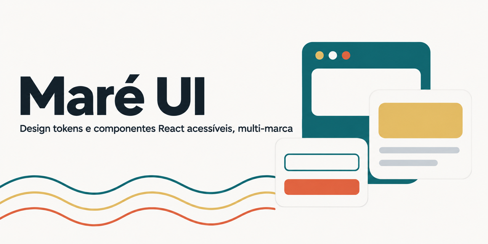

<p align="center">
  
</p>

# Maré UI

[Português](README.md) · **English**

[](https://github.com/mandfront/mare-ui/actions/workflows/ci.yml)
[](https://www.npmjs.com/package/@mare-ui/react)
[](https://docs-rosy-two-80.vercel.app)
[](LICENSE)

**[Docs and examples in Storybook](https://docs-rosy-two-80.vercel.app)**

A multi-brand design system: one set of design tokens and accessible React components that serves several brands at once. Switching brands means switching token values, never rewriting components.

> **Work in progress.** The foundation, [design tokens](packages/tokens), Storybook, the first [components](packages/react) and an example app are ready. More comes in the next steps of the [roadmap](#roadmap).
>
> The code and the docs are written in Portuguese, including the architecture decision records.

## Principles

1. **Tokens first.** No component uses a hard-coded color, spacing or font.
2. **Accessible by default.** At least 4.5:1 contrast for text, keyboard focus always visible, nothing relies on color alone.
3. **Composition over configuration.** Small parts instead of components full of props.
4. **Motion with a purpose.** Short animations, only to show a change of state, turned off with `prefers-reduced-motion`.
5. **Ready for people and agents.** Docs, types and a Storybook MCP server, so an AI can build screens without making up props.

## Structure

```text
mare-ui/
├─ packages/
│  ├─ tokens/        # design tokens (W3C/DTCG format)
│  └─ react/         # React components
├─ apps/
│  ├─ docs/          # Storybook: docs, browser tests and MCP
│  └─ playground/    # Next.js example app, rendered on the server
├─ docs/decisions/   # architecture decision records (ADRs)
└─ .github/          # CI, PR and issue templates
```

## Tech stack

| Area     | Choice                                                                   | Decision                                                            |
| -------- | ------------------------------------------------------------------------ | ------------------------------------------------------------------- |
| Monorepo | pnpm workspaces + Turborepo                                              | [0002](docs/decisions/0002-monorepo-com-pnpm-e-turborepo.md)        |
| Behavior | Base UI                                                                  | [0003](docs/decisions/0003-base-ui-como-camada-de-comportamento.md) |
| Styling  | Tailwind CSS v4 + CVA                                                    | [0004](docs/decisions/0004-estilo-com-tailwind-v4-e-cva.md)         |
| Tokens   | JSON in the DTCG format + Style Dictionary                               | [0005](docs/decisions/0005-tokens-no-formato-dtcg.md)               |
| Delivery | npm + shadcn registry + Storybook with MCP                               | [0006](docs/decisions/0006-distribuicao-por-npm-e-registry.md)      |
| Workflow | GitHub Flow, Conventional Commits, Changesets                            | [0007](docs/decisions/0007-fluxo-de-git-e-versionamento.md)         |
| Quality  | Strict TypeScript, ESLint, Prettier, Vitest, Testing Library, Playwright | [CONTRIBUTING](CONTRIBUTING.md)                                     |

## Use it

```bash
npm install @mare-ui/react
```

```tsx
import '@mare-ui/react/styles.css';
import { Button } from '@mare-ui/react';
```

Or copy a component into your project as source code, through the shadcn registry:

```bash
npx shadcn@latest add mandfront/mare-ui/button
```

If your project already uses Tailwind, see the setup in the [package README](packages/react#com-tailwind-no-projeto).

## Run it locally

Requirements: Node 22.12 or newer and pnpm through Corepack.

```bash
corepack enable pnpm
pnpm install
pnpm check   # format, lint, types, tests and build
```

## Roadmap

- [x] Foundation: monorepo, lint, types, tests, Git hooks, CI and recorded decisions
- [x] Tokens: DTCG format, Style Dictionary, light and dark themes and brands, with tested contrast
- [x] Storybook with interaction, accessibility and MCP tests
- [x] Components: Button, Badge, Card, Avatar, TextField, Checkbox, Switch, Tabs, Alert and Dialog
- [x] First release (0.1.0) on npm and the shadcn registry
- [x] Next.js example app built only with the design system, tested end to end

## Contributing

See [CONTRIBUTING](CONTRIBUTING.md) (in Portuguese). Architecture decisions are in [`docs/decisions`](docs/decisions).

## License

[MIT](LICENSE) © Amanda Caraça
